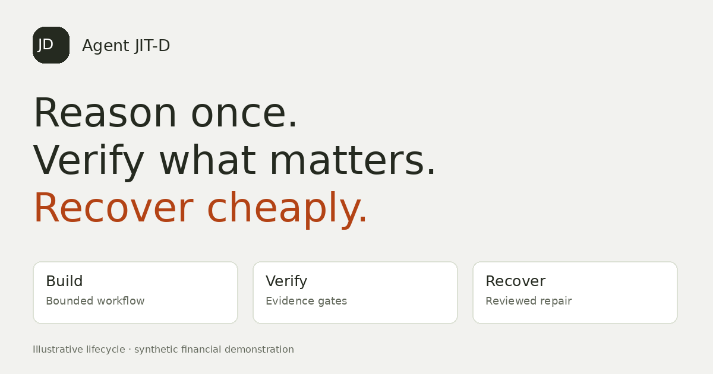

# Agent JIT-D

**Reason once. Verify what matters. Recover cheaply.** Reuse a bounded invoice workflow, block invalid evidence, and recover through reviewed parameter repairs.

Start locally at **http://127.0.0.1:8000/demo** for the seven-step guided lifecycle. The deployment owner must supply the tested public URL and private judge credentials; no hosted link or new video is claimed in this ZIP.



## How Nemotron is used

Nemotron on Nebius Token Factory proposes bounded drafting parameters and repair candidates. Deterministic checks and reviewer approval decide promotion. Raw provider receipts, rejected proposals and fallbacks remain distinguishable. Clean execution does not call a model. Synthetic services and model availability are separate dimensions.

## Measured evidence

No raw live provider report or paired live cost result is bundled. Historical user-session observations are not reproducible benchmark evidence. `/demo` replays actual `source_mode=nebius_api` reports only when supplied. Cost projections do not establish savings. Collect evidence using [deployment instructions](DEPLOYMENT.md).

## Run and deploy

Use Python **3.12** and `requirements.txt` for the pinned production runtime; use `requirements.lock` for the complete test closure. See [Deployment](DEPLOYMENT.md), [Judge instructions](docs/JUDGE_TESTING.md), [Architecture](docs/ARCHITECTURE.md), [Limitations](LIMITATIONS.md), [Review updates](docs/UPDATE_STATUS.md), and [Verification](docs/FINAL_VERIFICATION.md).

The recommended hosting target is one persistent Render Docker service. Vercel remains a zero-call ephemeral preview. The shared demo profile supports one user reviewing synthetic examples; named-role enterprise mode enforces a separate reviewer.

---

## Run on Windows PowerShell

Extract the ZIP and open a terminal in this `jitd` folder:

```powershell
py -3.12 -m venv .venv
.\.venv\Scripts\python.exe -m pip install -r requirements.lock
.\.venv\Scripts\python.exe -m jitd.launch
```

Open **http://127.0.0.1:8000**. Model calls are disabled by default. [Windows quickstart](QUICKSTART_WINDOWS.md) includes
hidden API-key entry and the named-user profile. The original lab remains at `/lab`; system controls are at `/operations`.

## The complete path

Create a supported invoice draft, inspect its fixed tool bindings, test its 28 synthetic cases, and publish the exact tested
version. Run a clean input, apply dollars→cents drift, inspect the block, propose a repair, review its recorded-input impact,
approve/revalidate, and retry the same invoice. Remove authority evidence to see UNKNOWN continue to block acceptance.
Editing a draft invalidates its validation eligibility; a published base is immutable.

| Capability | Implemented boundary |
|---|---|
| Builder | Conservative task-to-template routing, one invoice family and bounded page parameter editing |
| Test and publish | Content/report/runtime-policy hashes, revisions and separate publication review in named-user mode |
| Run and recover | Per-version runtime; exact repair candidate; recorded-input impact plus fresh strict checks before promotion |
| Evidence Passport | Run/output/manifest hashes, evidence observations, source snapshot and approval provenance in a local chain |
| Model contribution | Architect and Repairer receipts; raw output, model ID, usage and labelled fallback |
| Economics | Actual usage counts plus a clearly labelled assumption-based break-even curve; no measured savings claim |
| Deployment | Named roles, persistent attempted-call ceiling, idempotent execution, one-process lock and offline backup/restore |

## What the results support

See [release verification](docs/RELEASE_VERIFICATION.md) for tests/browser checks and [plan review](docs/PLAN_REVIEW.md) for
accepted changes and corrected claims. Historical [recovery evaluation](docs/EVALUATION.md) remains synthetic. Ordinary
dependency replay can match or outperform semantic reuse here. A correlated wrong authority can certify a wrong provider.

No actual paid model result, independent field validation, Windows run, Docker runtime, customer savings, arbitrary trace
compilation, enterprise certification, SSO, tenant isolation or high availability is claimed. The old recorded video is
historical synthetic footage, not a live-model demonstration of Studio. No additional inference roles are fabricated.

## Relationship to existing work

| Existing work | Documented overlap | JIT-D's scoped focus |
|---|---|---|
| [Stagehand caching](https://docs.stagehand.dev/v4/best-practices/caching) | Reuses eligible repeated actions/extractions without inference | Explicit monetary evidence gate before accepting invoice outputs |
| [Skyvern code caching](https://skyvern.com/docs/developers/features/code-caching) | Related reusable browser automation; current documentation was unavailable during this audit | No exhaustive feature comparison or superiority claim |
| LangGraph / incremental computation | Checkpoints, recovery, dependency-aware recomputation | Integration of bounded invoice repair and reviewable evidence |

This is an integration contribution, not a claim that caching, contracts or slicing are new.


[Studio guide](docs/STUDIO.md) · [Operations](docs/OPERATIONS.md) · [Architecture](docs/ARCHITECTURE.md) · [Limitations](LIMITATIONS.md).

Optional historical research reproduction: install requirements-research.lock and run `python scripts/reproduce.py`.
That command does not call a paid model. Run checks with `python -m pytest -q`.

## Semantic Change Assurance (2.2)

Studio → Runs → **Plan revalidation** shows required obligations and budget coverage. This is shadow planning: fresh strict verification remains authoritative. See [behavior and limits](docs/SEMANTIC_CHANGE_ASSURANCE.md).

## Visual builder (2.3)

Open **http://127.0.0.1:8000/builder** or follow Visual agent builder from Studio. Drag and reorder typed blocks across ten bounded JSON template families, validate, publish and execute local results. Models & keys adds two memory-only connections for Nebius/NVIDIA and cost receipts with reported token usage. See [the complete guide](docs/VISUAL_BUILDER.md) for supported semantics, key handling and measured-versus-projected costs. The original invoice Studio retains the deeper reviewed recovery integration.

## Hybrid assurance (2.4)

Visual workspace → **Hybrid assurance** shows persistent robust/CUSUM signals, verified predicate counts, graph cause ranking and expected-risk recommendations for both workspaces. Optional policy-gated diagnosis dispatches a model only for eligible ambiguous failures. Missing evidence and known local faults do not trigger calls. See [the controller guide](docs/HYBRID_ASSURANCE.md) for setup, assumptions and experiments. The historical Beta mean is a proxy, not a calibrated silent-error probability.


For Nebius API credentials and a bounded connection check, see [Nebius Token Factory setup](docs/NEBIUS_SETUP.md).

## Selected design refresh (2.5)

Open **http://127.0.0.1:8000/** for the new Axion-inspired product home. Its buttons open the actual visual builder and invoice Studio. The light/orange design extends across the workspaces, system page and original lab. The hero uses a local fluid WebGL effect with reduced-motion support and CSS fallback. Startup stays Python-only. See [design notes](docs/DESIGN_SYSTEM.md).

### Cursor motion and responsive layouts (2.5.1)

The hero follows fine-pointer movement, editorial cards react subtly, and homepage buttons have a light magnetic response. Touch layouts use navigation rails, stacked forms and larger targets. Reduced-motion preferences disable decorative interaction. See docs/DESIGN_SYSTEM.md for verification scope.


## Hackathon submission and Vercel demo

See [SUBMISSION_PACKAGE.md](SUBMISSION_PACKAGE.md) for the tester path, accurate model-use wording, recorded local receipts and checklist. [VERCEL_DEPLOY.md](VERCEL_DEPLOY.md) explains the protected demo deployment and its temporary-storage limits. Vercel configuration is a demo adapter; durable multi-instance operation requires managed persistence.
